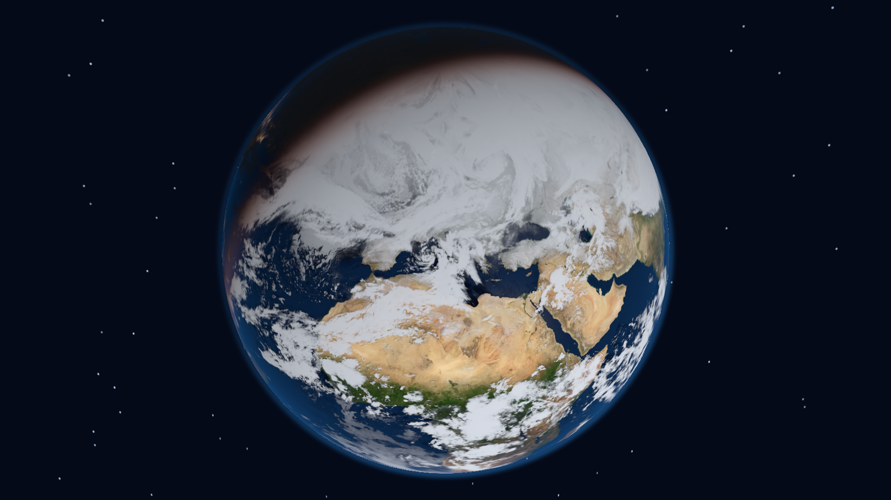

# Native Earth wallpaper

A KDE Plasma 6 wallpaper drawn directly by Qt Quick on the GPU. The installed wallpaper uses no Chrome, Qt WebEngine, Node server, separate window, or background service. The browser app in this repository is a development/reference preview only.

The view starts above Rome, lets you orbit/zoom, and returns to a saved home view after the selected delay. Zooming closer reduces orbit speed. Sunlight and Sun/Moon positions use Astronomy Engine with the computer's UTC time. High quality is the native default: 4096×2048 surface/cloud maps, 2048×1024 night/ocean maps and a 1024×512 Moon. Balanced uses 2K principal maps; Low power uses 1K.

## Install as a native wallpaper

Requires KDE Plasma 6 with Qt 6.8+ / Qt Quick and a working hardware OpenGL or Vulkan scene graph. Prebuilt shader packages, astronomy code and textures are included under `plasma/org.kde.plasma.earth/contents/`.

```sh
git clone https://github.com/All-Light/earth-wallpaper.git
cd earth-wallpaper
./scripts/install-plasma.sh
# Desktop Settings → Wallpaper → Earth wallpaper → Apply
```

The installer copies the package into the user's Plasma wallpaper directory. It retires the earlier Earth web-server service if installed. It does not activate the wallpaper or change GTK settings. No browser/server is required at runtime. To remove the package, run `./scripts/uninstall-plasma.sh`.

Right-click the desktop for **Earth wallpaper settings**. Save the current angle as home, or reset home to Rome. Clock, stars, clouds, return delay and quality are configurable.

## Idle behavior and input

After 45 seconds without interaction, once any configured home return completes, the wallpaper captures an image capped at 1920 pixels on its longest side and unloads the shader/texture items. It refreshes every 15 minutes. Dragging or scrolling on empty desktop space wakes the native renderer. The optional clock updates once per minute.

The native shader does not run a continuous animation loop when the view is stationary: camera movement requests frames; lighting updates every five seconds while awake. During scheduled refreshes, the bundled map displays immediately and live clouds get up to five seconds before the idle snapshot. Network failure keeps the bundled fallback.

Passive input handlers reject occupied icon cells and applets, including labels, and never give keyboard focus to a renderer window. KDE's empty placeholder grid cells are accepted. Unknown desktop layouts disable gestures conservatively. Actual icon open/drag/context-menu delivery remains unverified in a real Plasma session.

## Measured native performance

On the NVIDIA GTX 1060, using an isolated Qt Quick/Vulkan render-control harness at 1920×1080 with High/4K textures:

| Measurement | Result |
| --- | --- |
| Qt application entry to first completed GPU frame | 406 ms |
| Subsequent native renderer reloads | 235–248 ms |
| Additional idle PSS above empty Qt/GPU baseline | 71–105 MiB (75–110 MB) |
| Whole isolated Qt process at idle | 142–175 MiB (149–184 MB) |

These are three renderer cycles, not an end-to-end desktop input guarantee. Timing begins inside `main()` and excludes executable loading and window presentation. The idle test retains a CPU snapshot; real Plasma also displays that snapshot as a texture and has its own existing memory footprint. The revised 200 MB additional-idle budget has headroom in this test. Active rendering uses more memory. Full desktop lifecycle/idle CPU behavior still needs validation in a safe environment.



## Build and checks

Native assets can be rebuilt with Node/npm, Python/Pillow and Qt Shader Baker (`qsb`, Qt 6.8 or compatible). Set `QSB=/path/to/qsb` if necessary. Installing the included native package does not require these build tools.

```sh
npm ci
npm run build:native
npm test
```

The native shader and QML component have rendered successfully on hardware. The astronomy bundle targets ES2016 for Qt's parser. Unit checks cover astronomy, camera conventions, home migration and waiting for long return delays before sleep. Native integration also received source review.

Do not launch Plasma/KWin or desktop/theme services for testing: earlier session tests coincided with GTK applications crashing after a shared decoration CSS change. The native verification instead used an authenticated private X server, offscreen Vulkan rendering, private XDG paths, disabled GTK modules and no session bus. Local diagnostic artifacts and desktop configuration backups are excluded from this repository.

## Optional browser reference

```sh
npm run dev
npm run build
npm start
```

The browser reference remains available for development and has its own memory overhead. It is not the installed wallpaper.

## Image sources and attribution

- Earth surface: NASA Blue Marble: Next Generation base map, July 2004, 5400×2700. [NASA Science](https://science.nasa.gov/earth/earth-observatory/blue-marble-next-generation/base-map/). NASA imagery is public domain unless stated otherwise.
- Night lights: NASA Black Marble 2016 grayscale global composite, 3600×1800, based on Suomi NPP VIIRS data. [NASA Science](https://science.nasa.gov/earth/earth-observatory/earth-at-night/maps/). This is a historical annual lights composite, not live night imagery.
- Clouds: [Live Cloud Maps](https://github.com/matteason/live-cloud-maps), CC0; `clouds-alpha.png` is sourced from the project's `clouds.matteason.co.uk` endpoint and is derived from EUMETSAT imagery. Contains modified EUMETSAT data. The source says maps update about every three hours and mirrors polar regions, so cloud patterns near the poles can be duplicated or distorted; this wallpaper refreshes hourly and reports retrieval time only.
- Moon: [NASA Scientific Visualization Studio CGI Moon Kit](https://svs.gsfc.nasa.gov/4720/), LROC 2025 color map; credit NASA SVS / Ernie Wright.
- Ocean mask: Live Cloud Maps specular texture, CC0, with the same EUMETSAT attribution.
- Astronomy: [astronomy-engine](https://github.com/cosinekitty/astronomy), used for geocentric Sun/Moon vectors. Its vectors are converted from AU to kilometers before physical scale is applied.

Local copies of the source images are in `public/assets/`. The surface map and night lights are static composites; only the cloud layer is updated from a weather feed. Atmosphere and exposure are artistic approximations. Stars are a decorative inertial field, not a catalog of real constellations. Moon orientation is approximately tidally locked; lunar libration and eclipse shadows are not simulated. If the live cloud endpoint is unreachable, the bundled cloud image remains in use and the status says so.
